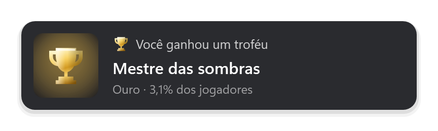
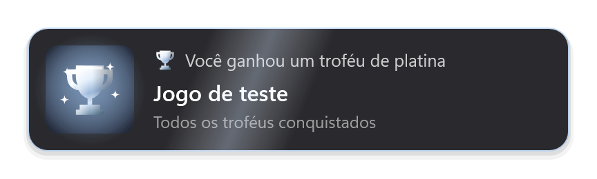
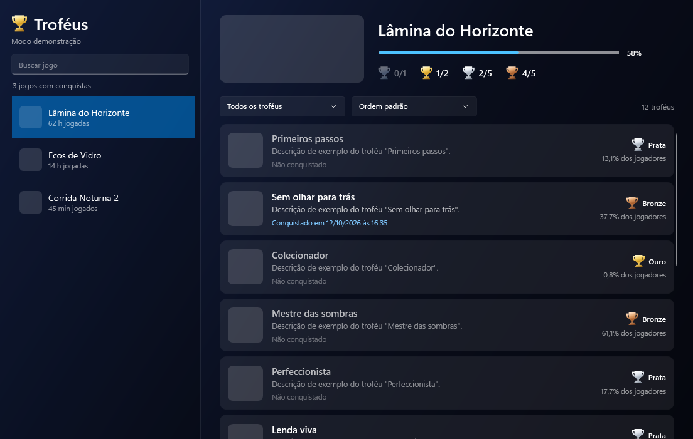
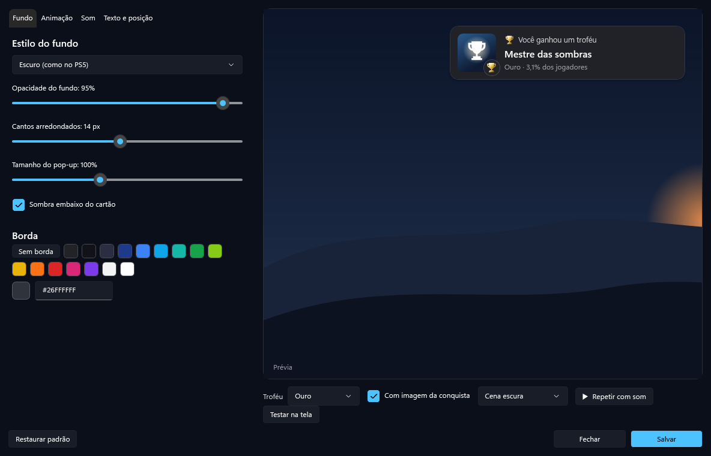
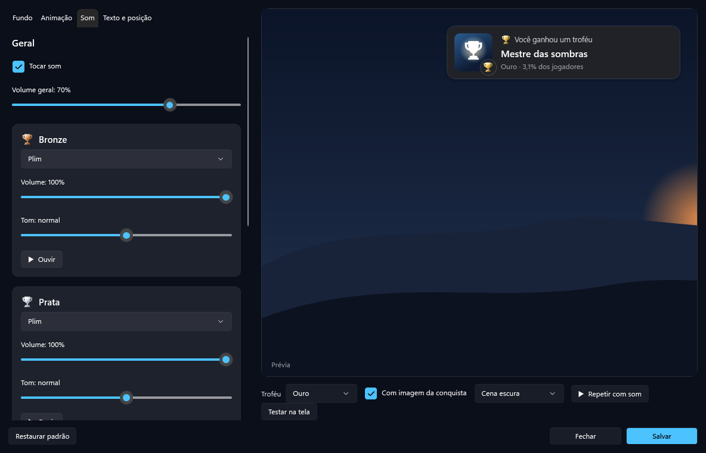
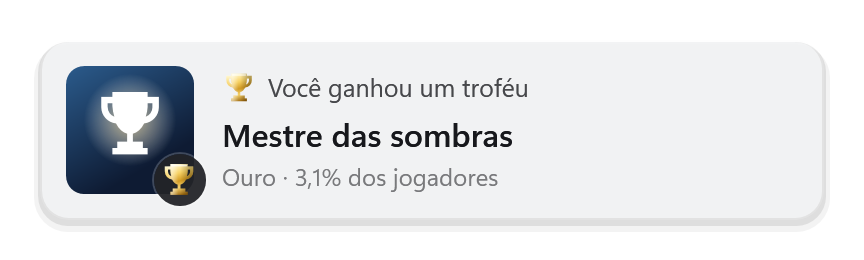

# TrophyPop

Pop-ups de troféu no estilo PS5 para as conquistas da Steam, no Windows.




## Como usar

1. Baixe o `TrophyPop.exe` na página de **Releases** deste repositório. Não precisa instalar nada.
2. Abra o arquivo. Um troféu aparece perto do relógio do Windows e a janela de configurações abre.
3. Crie sua chave da API em https://steamcommunity.com/dev/apikey (no domínio pode colocar `localhost`) e cole a chave no app.
4. Na Steam: Perfil › Editar perfil › Privacidade › **Detalhes de jogos: Público**.
5. Clique em **Testar conexão** e depois em **Salvar**.

Depois disso é só jogar. O app vê sozinho qual jogo da Steam está aberto.

### Perfil unificado (várias contas da Steam)

Se você tem conquistas e platinas divididas em mais de uma conta da Steam (por exemplo, uma conta antiga e uma conta nova), basta informar os SteamIDs ou links dos perfis separados por vírgula nas **Configurações** (ou clicar em **+ Conta logada agora**). O TrophyPop junta todos os seus jogos, troféus, platinas e capturas numa vitrine só, e detecta automaticamente qual conta está aberta na hora em que você estiver jogando.

## Capturas no estilo PS5 (prints e clipes de Platina)

Pensado para não lotar o seu SSD mesmo quando você tiver centenas de platinas:

- **Bronze, Prata e Ouro**: salva apenas um print leve (`.jpg`) no momento exato em que o pop-up está aberto na tela.
- **Platina**: grava um clipe curto em vídeo (`.mp4` em H.264) pegando a conquista final e a entrada da Platina. O gravador roda em um processo separado apenas durante os segundos da comemoração e sai da memória assim que o vídeo fecha.

Você pode ver os prints de cada conquista e assistir aos clipes de Platina direto na **Lista de troféus** (ou abrir a pasta `%APPDATA%\TrophyPop\capturas` pelo menu do ícone na bandeja).

## Tipos de troféu

A Steam não tem tipos de troféu. Aqui o tipo vem da raridade (você pode mudar os limites):

| Troféu  | Quando                                       |
|---------|----------------------------------------------|
| Ouro    | menos de 7% dos jogadores têm a conquista    |
| Prata   | menos de 25%                                 |
| Bronze  | o resto                                      |
| Platina | quando você completa 100% das conquistas     |

## Menu do ícone perto do relógio

- **Lista de troféus**: seus jogos, troféus, prints e clipes de Platina, com filtros e ordenação. Também abre com dois cliques no ícone.
- **Pasta de capturas (prints e clipes)**: abre a pasta onde ficam salvos os `.jpg` e `.mp4`.
- **Personalizar (fundo, animação e som)**: abre o Estúdio.
- **Configurações da conta Steam**
- **Testar pop-up**: mostra um exemplo de cada tipo.



## Estúdio de personalização

Tudo com prévia ao vivo, numa "cena de jogo" escura, clara ou colorida para ver o contraste:

- **Fundo**: escuro (como no PS5), vidro, claro, cor sólida, degradê ou uma imagem sua (com opção de escurecer); opacidade, cantos arredondados, tamanho, sombra e cor da borda.
- **Animação**: entrada como no PS5 (abre a partir do ícone), deslizando da borda, surgindo suave ou caindo e quicando; velocidade e tempo na tela; e o que a taça faz (pulo e balanço, brilho no metal, faíscas, luz atrás).
- **Som**: um som para cada tipo de troféu. Escolha entre 7 sons prontos (Plim, Arpejo, Sino, Cristal, Moeda, Fanfarra, Suave) ou um arquivo seu (mp3, wav, wma, m4a, aac), com volume e tom para cada um.
- **Texto e posição**: os textos do pop-up, mostrar ou não a raridade, a cor do texto e o canto da tela.

Ao salvar, o app já passa a usar as escolhas, sem reiniciar. O Estúdio roda como um programa separado e sai da memória por inteiro quando você fecha, então não pesa no jogo.




| Degradê | Claro |
|---|---|
|  |  |

## Feito para não pesar no jogo

- Parado, o app fica dormindo: só acorda quando a Steam abre ou fecha um jogo (o Windows avisa) e, com um jogo aberto, para uma consulta pequena à Steam a cada 5 segundos.
- Roda com prioridade abaixo do normal e no "modo de eficiência" do Windows. Em processadores com núcleos de eficiência, ele fica nesses núcleos e deixa os rápidos para o jogo.
- O pop-up é desenhado pelo processador, num cartão pequeno e a no máximo 60 quadros por segundo, para não disputar a placa de vídeo com o jogo. A janela só existe enquanto o pop-up aparece.
- O gravador do clipe da Platina só liga quando você completa 100% de um jogo, num processo separado que fecha sozinho ao terminar o `.mp4`.
- Depois de cada pop-up ou janela fechada, o app devolve a memória sobrando ao Windows.
- Sons e código já vêm prontos desde a abertura do app, então nada é preparado na hora do troféu.

Medido parado: cerca de 9 MB de memória e quase nada de processador.

## Dicas

- Jogue em **tela cheia sem bordas** (ou janela). Em tela cheia exclusiva, o Windows não deixa nada aparecer por cima do jogo.
- Para usar seu próprio som, escolha o arquivo na aba **Som** do Estúdio.
- O pop-up aparece alguns segundos depois de você ganhar a conquista, que é o tempo da Steam atualizar.
- Se algo der errado, veja `%APPDATA%\TrophyPop\erros.log`.

## Compilar

Precisa do [.NET 10 SDK](https://dotnet.microsoft.com/download). O código fica na pasta `TrophyPop/` (C# / WPF).

```
dotnet publish TrophyPop -c Release -r win-x64 --self-contained true -p:PublishSingleFile=true -p:IncludeNativeLibrariesForSelfExtract=true -p:EnableCompressionInSingleFile=true -o TrophyPop-pronto
```

O `.exe` sai em `TrophyPop-pronto/`.

---

Projeto de fã, sem ligação com a Sony ou a Valve. A taça e os sons são originais deste projeto.
